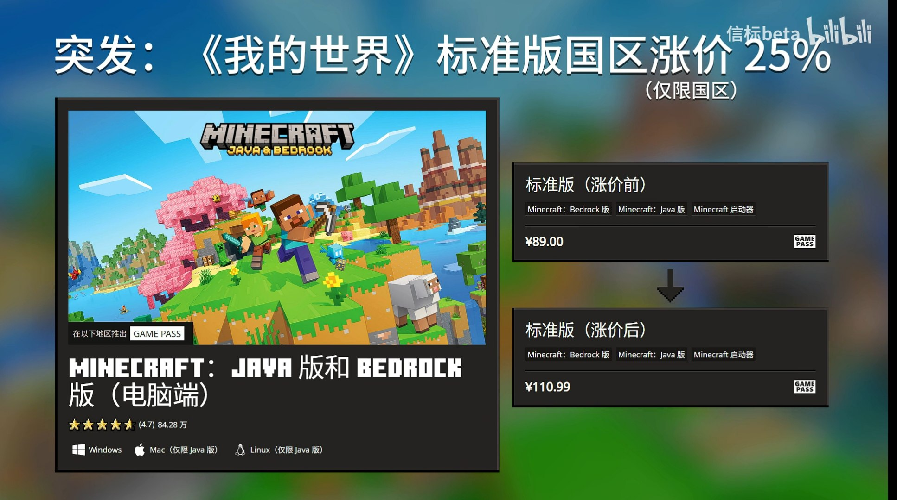
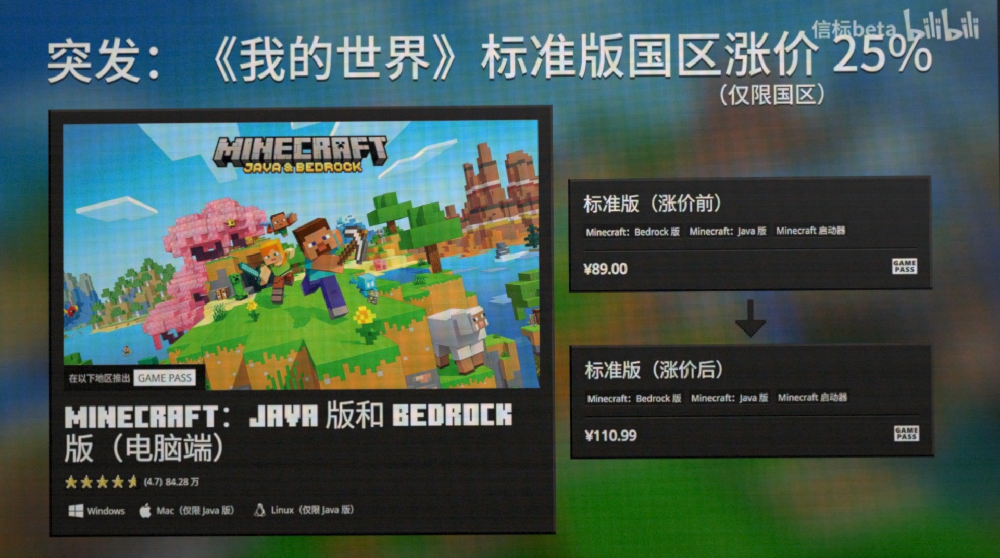
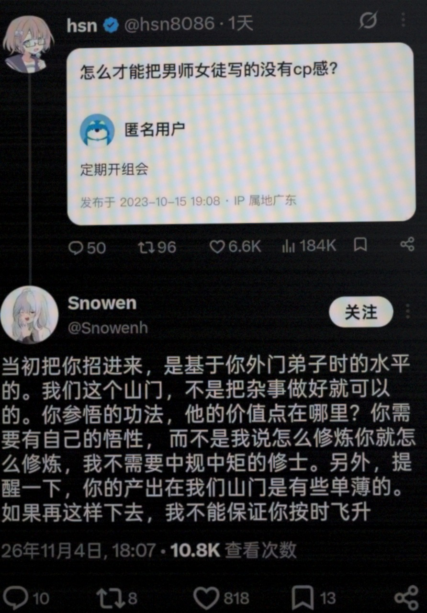

# screenphoto

把屏幕截图处理成手机拍屏照片。

| 原图 | 输出 |
|---|---|
|  |  |
|  |  |
|  |  |

## 工作原理

`screenphoto` 按手机拍屏的成像过程分三步生成 JPEG：

1. 按随机倾角做透视取景，轻微裁切边缘，叠加离焦模糊和暗角。
2. 叠加屏幕像素网格和玻璃反光。
3. 加入传感器噪声，经 Bayer 采样重建彩色摩尔纹，完成白平衡和色调映射后编码为无 EXIF 的 JPEG。

取景保留原图中央 90% 宽高区域，默认无径向畸变，页面直线保持笔直。输出长边上限为 `1920`，小图保持原尺寸不放大。边缘需要保留的文字请留出边距。超长截图想看清局部文字时，先裁出对应区域再转换。

更多样图：[彩图缩略图](samples/thumbnail.jpg) · [随机种子对比](samples/seeds.jpg) · [实拍对照](samples/reference.jpg) · [12 类输入总览](samples/corpus.jpg)

## 安装

### 为 Agent 安装

把这句话发给 Agent：

```text
帮我安装 screenphoto 技能：https://raw.githubusercontent.com/pjx1314/screenphoto/main/docs/install.md
```

也可以在终端用 [skills](https://github.com/vercel-labs/skills) 安装 Release 压缩包：

```bash
# Linux：安装后进入 skills 输出的实际技能目录执行 chmod +x bin/screenphoto
npx skills add https://github.com/pjx1314/screenphoto/releases/latest/download/screenphoto-linux-x86_64.zip --skill screenphoto

# Windows
npx skills add https://github.com/pjx1314/screenphoto/releases/latest/download/screenphoto-windows-x86_64.zip --skill screenphoto
```

`skills add` 默认安装到当前项目，全局安装加 `-g`。该命令把 `SKILL.md` 和 `bin/screenphoto` 装入技能目录供 Agent 调用，不会把命令加入系统 `PATH`。直接对源码仓库运行 `skills add` 只复制仓库文件，不包含预编译可执行程序。手动下载、权限设置、摘要校验和本地打包见 [安装说明](docs/install.md)，预编译包位于 [Releases](https://github.com/pjx1314/screenphoto/releases)。

### 安装命令行工具

要在终端直接运行 `screenphoto`，可通过 Cargo 安装，需要 Rust 1.88 以上版本：

```bash
cargo install --git https://github.com/pjx1314/screenphoto --locked
```

这条命令将 `screenphoto` 安装到 Cargo 的 `bin` 目录，不安装 Agent 技能目录。

## 用法

装好技能后，直接让 Agent 处理截图：

```text
把这张屏幕截图处理成拍屏照片后发给我。
```

终端直接调用：

```bash
screenphoto shot screenshot.png                  # 默认写入 screenshot-photo.jpg
screenphoto shot screenshot.png -o out.jpg --json
screenphoto capture --monitor 0 -o desktop.jpg   # 仅限 Windows
```

完整参数、JSON 字段和退出码见 [接口参考](docs/cli.md)。

## Rust 库

```toml
[dependencies]
screenphoto = { git = "https://github.com/pjx1314/screenphoto", default-features = false }
```

`default-features = false` 只编译渲染核心，不引入命令行依赖。

```rust
pub fn render_bytes(data: &[u8], seed: Option<u64>) -> screenphoto::Result<(Vec<u8>, u64)>;
pub fn render_rgb(width: u32, height: u32, pixels: Vec<u8>, seed: Option<u64>) -> screenphoto::Result<(Vec<u8>, u64)>;
```

`render_bytes` 接收 PNG 或 JPEG 字节，返回拍屏 JPEG 字节和实际使用的 `seed`。`render_rgb` 直接接收 `width * height * 3` 字节的 RGB8 像素。输入上限和调用示例见 [接口参考](docs/cli.md#rust-库)。

## 文档

- [安装说明](docs/install.md)
- [接口参考](docs/cli.md)
- [内部结构](docs/internals.md)
- [测试记录](docs/testing.md)
- [发布流程](docs/release.md)
- [更新记录](docs/changelog.md)
- [SKILL.md](SKILL.md)

## 参与开发

提交修改前先读 [AGENTS.md](AGENTS.md)，确认格式检查、Clippy 和全部测试通过。

## 许可证

MIT，见 [LICENSE](LICENSE)。
